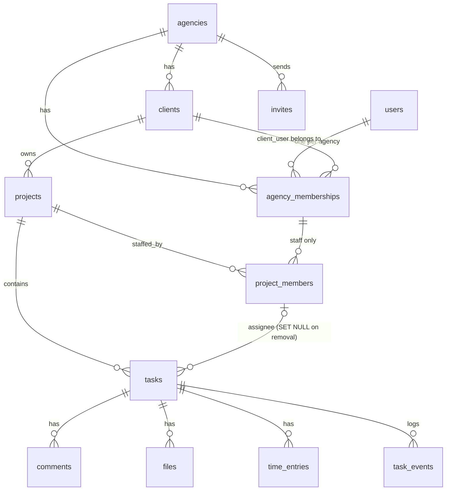

# AgencyDesk — Design Notes (study guide)

The longer version of DESIGN.md: every decision, why it was made, the alternatives, and the questions you're likely to get in the interview. Stack: React + FastAPI + SQLAlchemy (Core or ORM) + PostgreSQL 15+.

---

## 1. Terms used below

| Term | Plain meaning | How it's used here |
|---|---|---|
| **Tenant** | One customer whose data must be walled off from the others. | Each agency is a tenant. |
| **Composite foreign key** | A reference made of two columns instead of one, e.g. "(agency, project)". | A task points at `(agency_id, project_id)`, so it can only point at a project in its own agency. |
| **Row-Level Security (RLS)** | Postgres filters rows automatically based on rules attached to the table, whatever query is run. | Every SELECT/UPDATE/DELETE is silently limited to the caller's agency and visibility. |
| **Permissive vs restrictive policy** | Permissive rules are OR'ed ("any of these lets you in"). Restrictive rules are AND'ed ("all of these must pass"). | The tenant rule is restrictive, so no other rule can widen it. |
| **SECURITY DEFINER function** | A function that runs with its owner's rights rather than the caller's, a bit like `sudo` for a single query. | The visibility helpers look up projects/tasks without RLS calling itself in a loop. |
| **`SET LOCAL`** | Sets a setting that lasts only until the current transaction ends. | Holds the request's agency/user/role, so a pooled connection never leaks one request's context into the next. |
| **Partial unique index** | A uniqueness rule that applies only to rows matching a condition. | Only one *pending* invite per (agency, email). Old accepted invites don't count. |
| **Row lock / `FOR UPDATE`** | "I'm about to change this row; anyone else must wait until I finish." | Makes accepting an invite a one-winner operation. |
| **Soft delete** | Marking a row as removed (`removed_at`) instead of deleting it. | Memberships, so time entries and comments keep a valid author. |

---

## 2. Entity diagram



Global tables: `agencies`, `users`. Everything else is a tenant table with `agency_id`.

---

## 3. Isolation in three layers

1. **Schema (composite FKs).** Wrong-tenant references are impossible to *store*. This holds even for a migration script or an admin console that bypasses RLS.
2. **RLS.** Wrong-tenant or hidden rows are impossible to *read or modify* through the API role. It covers every query, including ones written later by someone who never read this doc.
3. **Service layer.** Business rules and friendly errors (e.g. "only admins can invite"). This layer is the convenience; the security comes from the two below it.

**Interview line:** "If I deleted every `WHERE agency_id` in the Python code, the tests would still pass. That's the point."

### Why not schema-per-tenant or database-per-tenant?
- *Pros:* stronger physical separation.
- *Cons:* migrations run N times, connection pools multiply, and cross-tenant reporting for operators gets hard. For many small agencies, a shared schema with RLS is the standard trade-off. Mention that you'd move a very large or regulated tenant to its own database if needed.

### What RLS does *not* protect against
A compromised API server could `SET LOCAL app.agency_id` to anything. RLS protects against *bugs*, not a fully compromised backend. Mitigations: the context comes only from the DB membership lookup, and there is a code review rule that `set_config` is called in exactly one place (`get_tenant_db`).

---

## 4. Request lifecycle (FastAPI)

```
Browser ──Bearer token {user_id, agency_id}──▶ FastAPI
  1. verify token signature/expiry                                   → 401 if bad
  2. BEGIN  (pool logs in as agencydesk_api: not owner, no BYPASSRLS)
     SET LOCAL ROLE agencydesk_api
     set_config('app.agency_id' | 'app.user_id', <from token>, true)
  3. load membership (user_id, agency_id) WHERE removed_at IS NULL   → 401 if gone
     (runs under RLS; the "own row" branch of the agency_memberships read policy)
  4. set_config('app.role' | 'app.client_id', <from membership row>, true)
  5. route → service → repository (plain queries, no tenant filters needed)
  6. COMMIT / ROLLBACK  (settings vanish with the transaction)
```

**Why the membership lookup runs under RLS.** The tenant policy hides every row until the context is set, but the context needs the role, which lives in a row. Rather than doing the lookup with a role that skips RLS, the `agency_memberships` read policy has one extra branch: `user_id = app.user_id()`, meaning "you can always see your own membership". Once the full context is set, that branch reveals nothing the other branches don't already show. Without it, a `client_user`'s own row is hidden during the lookup (their `client_id` isn't known yet) and they could never authenticate. `tests/test_api.py` proves this.

- The agency comes from the **token**, never from the URL or the body. So `/projects/{id}` with another tenant's id simply returns 404.
- Return **404, not 403**, for rows you can't see, so you don't confirm the row exists.
- Re-reading the membership on every request is one indexed primary-key lookup. In exchange, removal and role changes take effect instantly, which a long-lived JWT claim would not.

### Suggested backend layout
```
backend/app/
  main.py
  db.py            # engine, get_tenant_db dependency (the ONLY place context is set)
  auth/            # password hashing, tokens, login, select-agency, invites
  routers/         # projects.py, tasks.py, comments.py, files.py, time.py, dashboard.py
  services/        # rules + validation (e.g. client may only send {decision} for files)
  repositories/    # SQL; no tenant filters, RLS does it
  schemas/         # Pydantic request/response models (separate Client vs Staff views)
migrations/        # Alembic; first revision = db/schema.sql
tests/             # test_db_rules.py (DB level) + test_api.py (HTTP level)
```

---

## 5. API surface

| Method & path | Who | Notes |
|---|---|---|
| `POST /auth/login` | anyone | email+password → identity token + list of memberships |
| `POST /auth/session` `{agency_id}` | logged-in | → session token for that membership |
| `POST /invites` / `POST /invites/{id}/resend` / `DELETE /invites/{id}` | admin | resend = same upsert |
| `POST /invites/accept` `{token, name, password}` | public | calls `app.accept_invite` as `agencydesk_auth` |
| `GET/POST /clients` | admin (read: staff) | |
| `GET/POST /projects`, `GET /projects/{id}` | admin writes; all read (RLS-scoped) | |
| `POST/DELETE /projects/{id}/members/{user_id}` | admin | DELETE triggers auto-unassign |
| `GET /projects/{id}/tasks?status=&priority=&assignee=&q=` | all | search/filter safe by RLS |
| `POST /projects/{id}/tasks`, `PATCH /tasks/{id}` | staff | |
| `GET/POST /tasks/{id}/comments` | all | client POST forces `visibility=client` |
| `POST /tasks/{id}/files` (multipart) | staff | |
| `GET /files/{id}/download` | all (if visible) | RLS lookup → short-lived signed URL / stream |
| `POST /files/{id}/review` `{decision}` | client_user | approved / changes_requested |
| `POST /tasks/{id}/time-entries` | staff | |
| `GET /projects/{id}/dashboard` | all | counts by status + `app.project_hours()` |

**Separate login for clients.** The spec says clients log in separately. Use two entry points, `/login` (staff memberships only) and `/portal/login` (client memberships only), backed by the same `users` table. The portal UI is a separate React route tree with fewer screens. The data rules don't depend on which UI is used; RLS enforces them either way.

**Response models.** Use different Pydantic schemas for client responses (no `assignee` internals, no `visibility` field). This is a second guard against leaking fields, on top of RLS guarding rows.

---

## 6. The five edge cases: decisions and alternatives

### 6.1 Cross-tenant access
- **Decision:** composite FKs + restrictive RLS + agency taken from the token.
- **Test:** Bob (Northwind) selects/updates Pixel rows by exact UUID → 0 rows. An insert claiming `agency_id = Pixel` → RLS error. As the *owner* (RLS off), a Northwind task pointing at a Pixel project → FK error.
- **Likely follow-up:** "UUIDs are unguessable, isn't that enough?" No. IDs leak through logs, URLs and shared screenshots. Security must not depend on secrecy of IDs.

### 6.2 Internal content leaking to clients
- **Decision:** visibility lives in RLS read policies, and the effective visibility is `task AND child`. The default is `internal` (fail closed: forgetting to set the flag hides content rather than leaking it).
- **Paths covered:** list, get-by-id, search (`ILIKE`), filters, comments, files, file downloads, dashboard counts, hours.
- **Hidden leak sources to mention:** time entry notes (handled: clients get totals only), the activity log (`task_events` is staff-only), assignee names (membership read policy lets clients see staff names only, which is acceptable), and file *URLs* (downloads go through an RLS check; storage keys are not public).
- **Follow-up:** "What if a client-visible comment is on a task that later becomes internal?" It's hidden automatically because of the AND rule. There is a test for this.

### 6.3 One person, two agencies
- **Decision:** global `users` + per-agency `agency_memberships` with role and client. The primary key `(agency_id, user_id)` means one role per agency.
- **Trade-off to admit:** a person can't be a contact for *two clients inside the same agency*. If that's needed, change the key to `(agency_id, user_id, client_id)` or add a `membership_clients` join table.
- **Follow-up:** "Different passwords per agency?" No: one human, one credential. That's what the user expects and it avoids account confusion. SSO per agency would be a later feature.

### 6.4 Invite races
- **Resend:** the partial unique index plus upsert means one row; `send_count` goes up and the old token hash is replaced, so old links die.
- **Double accept:** `SELECT … FOR UPDATE` on the pending invite means one winner. The loser gets "invalid, expired or already used". The test uses two real threads.
- **Existing account:** `INSERT … ON CONFLICT (email) DO NOTHING` on users means the person is reused. In the real API, require that they're logged in as that email (or verify their password) before attaching the membership, so an invite link can't take over an existing account.
- **Re-inviting a removed member:** the membership upsert clears `removed_at`.
- Tokens are stored only as a SHA-256 hash, so a database leak doesn't hand out working links.

### 6.5 Removing a member mid-task
- **Decision:** unassign (not reassign, not block) and log it. Keep task status, comments and time entries.
- **Why:** blocking removal ("reassign first") stalls admins exactly when someone leaves. Auto-reassigning to the admin hides the problem. Unassigned tasks show up in an "Unassigned" filter where they can be reassigned on purpose.
- **Mechanism:** the FK `ON DELETE SET NULL (assignee_user_id)` (Postgres 15+ column-list syntax) plus a trigger that writes `auto_unassigned_member_removed`.
- **Removing someone from the whole agency:** set `agency_memberships.removed_at` and delete their `project_members` rows. That cascades to unassignment, and their history stays valid because the membership row still exists.

---

## 7. Other decisions worth defending

- **Status/priority as `CHECK` constraints rather than Postgres enums.** Adding a value is a simple migration, and the database still validates them.
- **Time in integer minutes**, capped at 1440 per entry (one day). Avoids float rounding; hours are computed for display.
- **File approval stored on the file row** (current state) plus `task_events` (history). A separate `file_reviews` table is the upgrade path if multiple reviewers or versions are needed.
- **Approval only on client-visible files:** enforced by a `CHECK (approval_status='pending' OR visibility='client')`.
- **Indexes lead with `agency_id`**, matching the RLS predicate on every query.
- **RLS performance:** the helper functions run per row. That's fine at this scale. At scale you'd inline simple predicates, or cache the user's project IDs in a setting (`app.project_ids`).

## 8. Bonus / discuss-only items

- **Intake forms (bonus):** `intake_forms (agency_id, schema jsonb)` + `intake_submissions (agency_id, form_id, client_id, answers jsonb)`. Submitting one can create a project.
- **Notifications (bonus):** an `outbox` table written in the same transaction as the event, with a worker that sends emails. Recipients are filtered by the same visibility rules (a client must never be emailed about an internal task).
- **Gantt (discuss only):** add `start_date` to tasks + `task_dependencies (agency_id, task_id, depends_on_id)` with a composite FK on both ends and a cycle check in the service layer. The client view shows client-visible tasks only, which raises an interesting question: should a hidden internal dependency move a client-visible bar's date? (Yes, but the hidden task itself isn't shown.)

## 9. Rapid-fire interview questions

1. *Where is the tenant check enforced?* In three places (schema, RLS, service), and the first two don't rely on application code.
2. *How does a request get its agency?* From the signed session token, then the membership is re-loaded from the DB. Never from the URL.
3. *Why `SET LOCAL` and not `SET`?* Pooled connections are reused; `SET` would leak one tenant's context into the next request.
4. *Why does the API role need to be a non-owner?* Table owners skip RLS by default.
5. *What breaks if someone adds a new table and forgets RLS?* That's the main risk. Mitigation: a test that queries `pg_class` and fails if any table with an `agency_id` column lacks RLS. (Worth adding to the repo.)
6. *How would you add audit for "who viewed what"?* Out of scope; you'd log at the service layer, since RLS can't log reads cheaply.
7. *Client asks to see time notes?* That's a product decision: add a `visibility` flag on time entries, using the same pattern.
